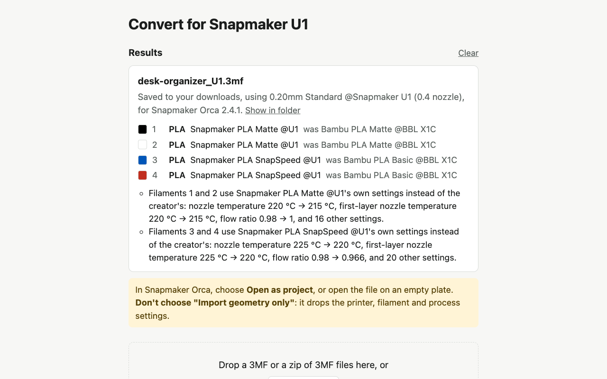
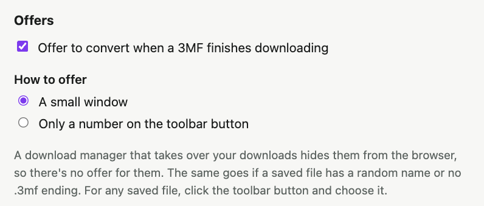
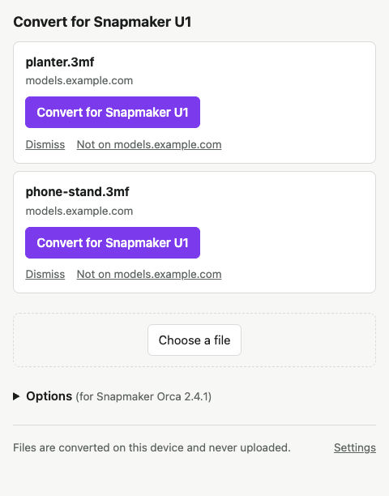
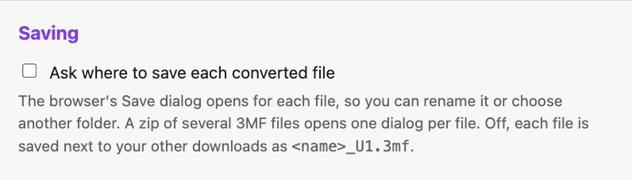
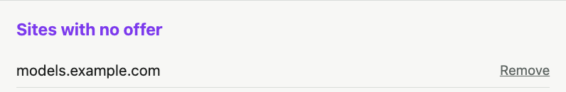
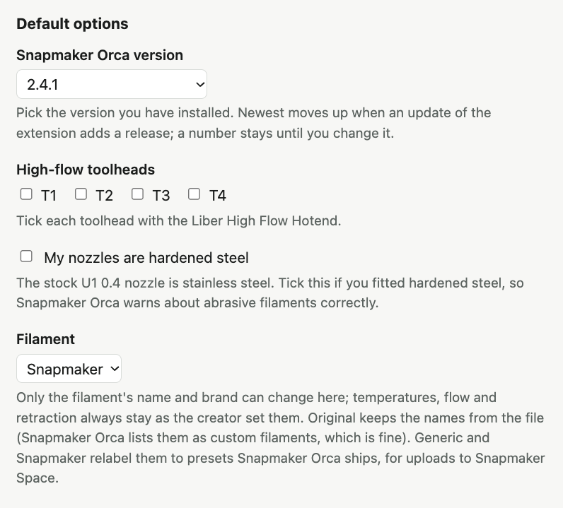
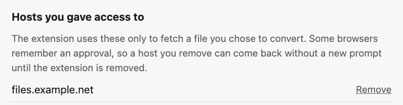
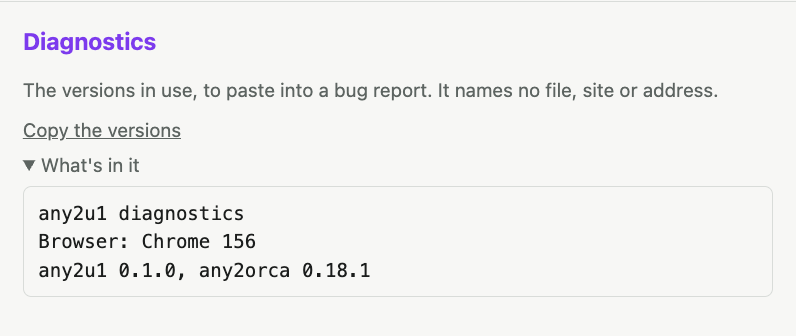

# any2u1

A browser extension that turns a 3MF project into a Snapmaker U1 file, on any site that offers a 3MF download. Download a model the way you always do, and it offers to convert it. The conversion runs entirely on your device.

It reads projects saved by Bambu Studio, Creality Print, Anycubic Slicer Next, ElegooSlicer, Flash Studio, PrusaSlicer and QIDI Studio. It's built on the [any2orca](https://github.com/KuzuriAo/any2orca) library.

It's tested on Chrome 156, Edge 156, Brave 1.99, Firefox ESR 153 and Firefox 159, and needs Firefox 153 or later. It's for desktop browsers: Firefox for Android has no downloads API for extensions, which any2u1 is built on. It isn't in any extension store yet, so for now you load it yourself.

## Supported slicers

| Slicer | Tested with |
|---|---|
| Bambu Studio | 2.8.4 |
| Creality Print | 7.3 |
| Anycubic Slicer Next | 2.0 |
| ElegooSlicer | 1.5 |
| Flash Studio | 1.7 |
| PrusaSlicer | 2.9.6 and 2.9.7 |
| QIDI Studio | 2.7.2 |

A project from another slicer gets a message naming it, and nothing is converted.

## Try it

You need [Node.js](https://nodejs.org/) 20.19 or newer and Git.

```sh
git clone https://github.com/KuzuriAo/any2u1.git
cd any2u1
npm install
npm run build
```

- **Chrome, Edge or Brave:** open `chrome://extensions`, `edge://extensions` or `brave://extensions`, switch on **Developer mode**, click **Load unpacked**, and choose `dist/chrome`.
- **Firefox:** open `about:debugging#/runtime/this-firefox`, click **Load Temporary Add-on**, and choose `dist/firefox/manifest.json`. Firefox removes a temporary add-on when it closes.

## How it works

1. A 3MF finishes downloading, and a small window asks whether to convert it. Prefer something quieter? In the settings you can switch to a number on the toolbar button, turn offers off, or turn them off for one site.
2. Click **Convert for Snapmaker U1**. The extension gets the file in one of these ways:
   - If the server allows it, it fetches the file again, with no cookies. No prompt appears.
   - If the server refuses, it explains and gives you a choice: allow access to that one host, or choose the copy you saved.
   - If the site built the file in the page, it can't be fetched again, so you choose the copy you saved. **Show where it was saved** opens the folder the browser put it in.
3. While it converts, the page shows the step it's on, a clock and a moving bar. **Stop** ends a conversion that's taking too long.
4. It saves `<name>_U1.3mf` next to your other downloads and shows any notes worth reading. **Show in folder** takes you to it. If you'd rather name each file and choose its folder, turn on **Ask where to save each converted file** in the settings, and the browser's Save dialog opens instead.

 

> [!WARNING]
> In Snapmaker Orca, choose **Open as project**, or open the file on an empty plate. **Don't choose "Import geometry only"**: it drops the printer, filament and process settings.

You can also click the toolbar button and hand it a 3MF, or a zip holding 3MF files, whenever you like. **Clear** empties the list of results; the files stay in your downloads. A zip download gets no automatic offer, because a download alone doesn't show what a zip holds.

## Settings

Open them with **Settings** at the bottom of the convert page. The footer names the build, which is worth quoting in a bug report.

### Offers



Turn the offer off, or choose how it comes: a small window (the default), or only a number on the toolbar button. For the number, pin the button to your toolbar, since the browser hides it on an unpinned extension. A download manager that takes over your downloads hides them from the browser, so they get no offer. For those, click the toolbar button and choose the saved file.

The small window, offering two downloads:



Only a number, here with one file waiting. Clicking the button opens the small window:


### Saving



**Ask where to save each converted file** opens the browser's Save dialog for each file, so you can rename it or choose another folder. A zip of several 3MF files opens one dialog per file, one after another. Off (the default), each file is saved next to your other downloads as `<name>_U1.3mf`.

### Sites with no offer



The **Not on** button beside an offer, which names the site, adds that site here. **Remove** brings its offers back.

### Default options



The same options are under **Options** on the convert page, and a change in either place is kept for the next file.

- **Snapmaker Orca version:** choose the version you run. A new install starts on the newest the extension holds, and stays there until you change it. A newer version arrives with an update of the extension, which the browser installs for you; the extension then says so, and you choose it once you've updated Snapmaker Orca. That notice stays until you click **Got it**, and comes back with the next new version. Choose **Newest** instead to move up with each update. Every version from 2.4.0 on stays in the picker; once there are many, the older ones sit under **Older versions**. It never goes online to check.
- **High-flow toolheads:** tick each toolhead fitted with the Liber High Flow Hotend. It's used only for a file whose nozzle has a high-flow profile, and the result says which toolheads it applied to.
- **My nozzles are hardened steel:** the stock U1 0.4 mm nozzle is stainless steel. Tick this if you fitted hardened steel, so Snapmaker Orca warns about abrasive filaments correctly. It applies to 0.4 mm files.
- **Filament:** Original (the default) keeps the names from the file. Generic and Snapmaker relabel them to presets Snapmaker Orca ships, for uploads to Snapmaker Space, which accepts a file only if every filament name starts with Snapmaker or Generic. Only the name and brand change; every filament stays, in its order and color, with the temperatures, flow and retraction the creator set.

### Hosts you gave access to



Each host you allowed, so the extension could fetch a file you chose to convert. **Remove** takes the access back. See [What it asks for](#what-it-asks-for).

The settings page also explains the red CORS error the browser logs when a site won't let the extension read a file. It's expected: the extension then offers its two choices.

### Diagnostics



**Copy the versions** copies the browser, extension and library versions, to paste into a bug report. It names no file, site or address. **What's in it** shows the exact text.

## What it asks for

- **`downloads`:** to see that a 3MF finished downloading, save the converted file, and show it in its folder.
- **`storage`:** to remember your settings.
- **Access to one host, only if you allow it:** to fetch a file you chose to convert, when that host's server won't otherwise let an extension read it. The browser's prompt is worded more broadly than what the extension does with it. It never asks for all sites. The settings page lists each host you allowed, and removes it. Chrome and Edge remember an approval, so a host you remove can come back without a new prompt until you remove the extension.

It has no content scripts, so it doesn't read the pages you visit.

## Privacy

Your files stay on your device. The only requests the extension makes are for its own files and, when you click convert, for the one file you chose. It has no accounts, analytics or telemetry. Browser tests check this on every request they see. It never runs in private windows, and the browser offers no way to allow it, so nothing you download in one reaches it.

## Development

```sh
npm run typecheck
npm test              # unit tests
npm run test:e2e      # builds, then runs the browser tests in Chromium
npm run lint:firefox  # builds, then checks the Firefox build with web-ext; any warning fails it
FIREFOX_BINARY=/path/to/firefox npm run test:firefox  # builds, then runs the Firefox tests
```

The browser tests need Playwright's Chromium once (`npx playwright install chromium`) and `openssl` to make a throwaway certificate for their local test site. They check, among other things, that the manifest asks for exactly the permissions above, and that the output is byte-for-byte what the library produces for the same file and options.

The Firefox tests need two Firefoxes from mozilla.org, installed once: Firefox ESR 153, the oldest the extension supports, and the current release. Run them with each. `FIREFOX_BINARY` is the program itself: on macOS, for example, `/Applications/Firefox.app/Contents/MacOS/firefox`, and on Linux the `firefox` in the unpacked folder. There's no driver to install.

`dist/chrome` also serves Edge and Brave; the Firefox build differs only in its manifest. The settings page names the commit a build was made from, so an older build still loaded in a browser is easy to tell apart.

## Building the release files

```sh
npm ci
npm run package
```

This builds, then writes three files to `dist`: `any2u1-<version>-chrome.zip` (for Chrome, Edge and Brave), `any2u1-<version>-firefox.zip`, and `any2u1-<version>-source.zip`, the committed source these are built from.

The build is reproducible. These two setups give byte-identical files: macOS on Apple silicon with Node.js 26.3.0 and npm 11.16.0, and Ubuntu 24.04 on ARM64 with Node.js 24.14.0 and npm 11.9.0, built as an ordinary user. To check a release, unpack its source zip, run the two commands above, and compare `dist/firefox` (or `dist/chrome`) with the unpacked extension. The build makes no requests beyond what `npm ci` downloads from the npm registry.

## Security

To report a security problem, see [SECURITY.md](SECURITY.md). Please don't open a public issue for it.

## License

[AGPL-3.0-or-later](LICENSE). The extension ships the license notices of the packages it bundles, in its `licenses` folder.
