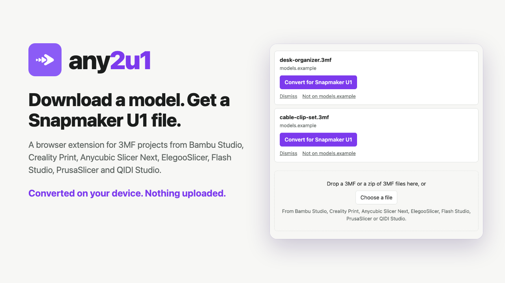
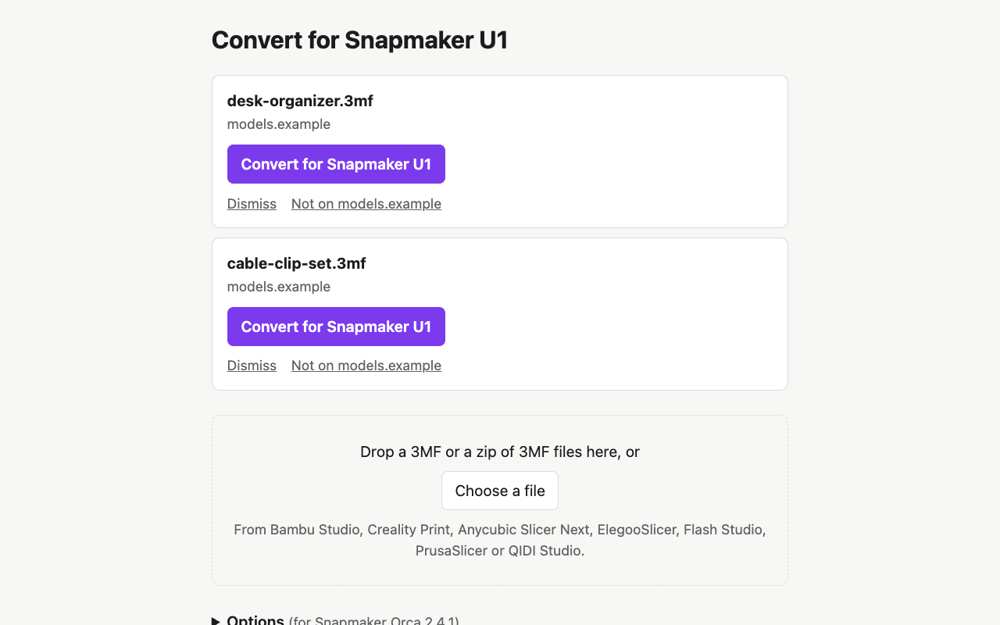

# any2u1

A browser extension that turns a 3MF project into a Snapmaker U1 file, on any site that offers a 3MF download. Download a model the way you always do, and it offers to convert it. The conversion runs entirely on your device.

It reads projects saved by Bambu Studio, Creality Print, Anycubic Slicer Next, ElegooSlicer, Flash Studio, PrusaSlicer and QIDI Studio. It's built on the [any2orca](https://github.com/KuzuriAo/any2orca) library.

It's tested on Chrome 156, Edge 156, Brave 1.99 and Firefox 159. It isn't in any extension store yet, so for now you load it yourself.

## Supported slicers

| Slicer | Tested with |
|---|---|
| Bambu Studio | 2.8.4 |
| Creality Print | 7.3 |
| Anycubic Slicer Next | 2.0 |
| ElegooSlicer | 1.5 |
| Flash Studio | 1.7 |
| PrusaSlicer | 2.9.6 and 2.9.7 |
| QIDI Studio | 2.7.2 |

A project from another slicer gets a message naming it, and nothing is converted.

## Try it

You need [Node.js](https://nodejs.org/) 20.19 or newer and Git.

```sh
git clone https://github.com/KuzuriAo/any2u1.git
cd any2u1
npm install
npm run build
```

- **Chrome, Edge or Brave:** open `chrome://extensions`, `edge://extensions` or `brave://extensions`, switch on **Developer mode**, click **Load unpacked**, and choose `dist/chrome`.
- **Firefox:** open `about:debugging#/runtime/this-firefox`, click **Load Temporary Add-on**, and choose `dist/firefox/manifest.json`. Firefox removes a temporary add-on when it closes.

## How it works

1. A 3MF finishes downloading, and a small window asks whether to convert it. Prefer something quieter? In the settings you can switch to a number on the toolbar button, turn offers off, or turn them off for one site.
2. Click **Convert for Snapmaker U1**. The extension gets the file in one of these ways:
   - If the server allows it, it fetches the file again, with no cookies. No prompt appears.
   - If the server refuses, it explains and gives you a choice: allow access to that one host, or choose the copy you saved.
   - If the site built the file in the page, it can't be fetched again, so you choose the copy you saved. **Show where it was saved** opens the folder the browser put it in.
3. While it converts, the page shows the step it's on, a clock and a moving bar. **Stop** ends a conversion that's taking too long.
4. It saves `<name>_U1.3mf` next to your other downloads and shows any notes worth reading. **Show in folder** takes you to it. If you'd rather name each file and choose its folder, turn on **Ask where to save each converted file** in the settings, and the browser's Save dialog opens instead.

 

When you open the file in Snapmaker Orca, choose **Open as project**, or open it from an empty plate. "Import geometry only" drops the printer, filament and process settings.

You can also click the toolbar button and hand it a 3MF, or a zip holding 3MF files, whenever you like. **Clear** empties the list of results; the files stay in your downloads. A zip download gets no automatic offer, because a download alone doesn't show what a zip holds.

**Options**, the same ones whichever way you start: the Snapmaker Orca version, which toolheads have the high-flow hotend, hardened steel nozzles, and filament names for Snapmaker Space.

**Snapmaker Orca versions:** choose the version you run. The default is the newest the extension holds, and it keeps up to three. A new version arrives with an update of the extension, which the browser installs for you, and the extension then tells you once. It never goes online to check.

## What it asks for

- **`downloads`:** to see that a 3MF finished downloading, save the converted file, and show it in its folder.
- **`storage`:** to remember your settings.
- **Access to one host, only if you allow it:** to fetch a file you chose to convert, when that host's server won't otherwise let an extension read it. The browser's prompt is worded more broadly than what the extension does with it. It never asks for all sites. The settings page lists each host you allowed, and removes it. Chrome and Edge remember an approval, so a host you remove can come back without a new prompt until you remove the extension.

It has no content scripts, so it doesn't read the pages you visit.

## Privacy

Your files stay on your device. The only requests the extension makes are for its own files and, when you click convert, for the one file you chose. It has no accounts, analytics or telemetry. Browser tests check this on every request they see.

## Development

```sh
npm run typecheck
npm test            # unit tests
npm run test:e2e    # builds, then runs the browser tests in Chromium
```

The browser tests need Playwright's Chromium once (`npx playwright install chromium`) and `openssl` to make a throwaway certificate for their local test site. They check, among other things, that the manifest asks for exactly the permissions above, and that the output is byte-for-byte what the library produces for the same file and options.

`dist/chrome` also serves Edge and Brave; the Firefox build differs only in its manifest. The settings page names the commit a build was made from, so an older build still loaded in a browser is easy to tell apart.

## Building the release files

```sh
npm ci
npm run package
```

This builds, then writes three files to `dist`: `any2u1-<version>-chrome.zip` (for Chrome, Edge and Brave), `any2u1-<version>-firefox.zip`, and `any2u1-<version>-source.zip`, the committed source these are built from.

The build is reproducible. These two setups give byte-identical files: macOS on Apple silicon with Node.js 26.3.0 and npm 11.16.0, and Ubuntu 24.04 on ARM64 with Node.js 24.14.0 and npm 11.9.0, built as an ordinary user. To check a release, unpack its source zip, run the two commands above, and compare `dist/firefox` (or `dist/chrome`) with the unpacked extension. The build makes no requests beyond what `npm ci` downloads from the npm registry.

## Security

To report a security problem, see [SECURITY.md](SECURITY.md). Please don't open a public issue for it.

## License

[AGPL-3.0-or-later](LICENSE). The extension ships the license notices of the packages it bundles, in its `licenses` folder.
